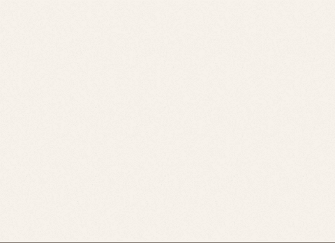

# silnikjava

Silnik JavaScript do **rysowanych animacji i filmów objaśniających** (explainer
videos): kreska piórem z naciskiem i drganiem, zamalowywanie kredką z ziarnem
papieru, pismo odręczne, ołówek rysujący na oczach widza, kamera, ścieranie
tablicy, sterowanie scrollem i eksport do wideo. Czysty JS (moduły ES), canvas
2D, bez zależności i bez kroku budowania.



Styl i technika wzorowane na animacjach z [stentor.studio](https://stentor.studio)
— szczegółowa analiza klatka po klatce w [docs/ANALIZA.md](docs/ANALIZA.md).

## Start

```bash
npm start            # serwer statyczny na http://localhost:8080
npm test             # testy jednostkowe (node:test)
```

Otwórz `http://localhost:8080` — galeria z trzema demami:

| demo | co pokazuje |
| --- | --- |
| `examples/hero.html` | scena ręcznie zaprogramowana na `Timeline` (maskotka, v1→v2→v3, nić poza kadr, idle) |
| `examples/explainer.html` | film ze `Storyboard`: kamera, ścieranie, odtwarzacz z suwakiem, nagrywanie WebM |
| `examples/scroll.html` | diagram budujący się podczas przewijania (sticky canvas + lista) |

## Najkrótszy film

```html
<link href="https://fonts.googleapis.com/css2?family=Caveat&family=Caveat+Brush&display=swap" rel="stylesheet" />
<canvas id="c"></canvas>
<script type="module">
  import { Player, Storyboard, rect, line, curve } from './src/index.js';

  const sb = new Storyboard({ w: 1280, h: 720 });
  sb.write('Jak działa agent?', 640, 110, { size: 72, font: 'title', align: 'center' });
  const box = rect(520, 260, 240, 160);
  sb.pen(box, { color: 'ink' });                       // ołówek obrysowuje
  sb.crayon(box, { color: 'teal' });                    // kredka zamalowuje (pod konturem)
  sb.write('LLM', 640, 365, { size: 80, align: 'center' });
  sb.arrow(curve([[770, 340], [900, 300], [1000, 340]]));
  sb.camera({ x: 640, y: 340, zoom: 1.8 }, { dur: 1.2 });
  sb.wait(1).camera({ zoom: 1 }).clear();               // zjazd kamerą i starcie tablicy
  sb.write('Koniec!', 640, 360, { size: 90, align: 'center' });

  new Player(document.getElementById('c'), sb.scene());
</script>
```

Ołówek sam podąża za aktualnie rysowaną kreską i przelatuje łukiem do początku
następnej. Czas każdego kroku liczy się z długości kreski (domyślnie 650 px/s)
albo z `dur`.

## Architektura

```
src/
  math.js        clamp, lerp, szum 1D, RNG z ziarnem, easingi
  paths.js       ścieżki jako tablice punktów: catmull, resample, pointAt,
                 line/rect/ellipse/circle/arc/polygon/star/wave/spiral, svgPath(d)
  sketch.js      Sketch — pędzle: pen, strokes, arrow, crayon, fill, liquid,
                 highlight, dot, write, pencil, paper, group, occlude
  timeline.js    Timeline — nazwane odcinki czasu (at / with / after / gap / ease)
  storyboard.js  Storyboard — deklaratywny scenariusz filmu + kamera + rozdziały
  player.js      Player (canvas, DPR, rAF, start w kadrze, idle, reduced motion),
                 scrollDrive (czas sceny = pozycja scrolla)
  record.js      recordWebM, snapshot, download
tools/render.mjs render klatka po klatce (Playwright) -> PNG / MP4 (ffmpeg)
```

**Zasada:** scena jest czystą funkcją czasu. `draw(sk, t)` rysuje wszystko od
zera dla czasu `t`, a każdy pędzel dostaje postęp `p ∈ [0,1]`. Wszystkie
„losowe” drgania pochodzą z ziaren, więc ta sama klatka zawsze wygląda tak samo
— można przewijać, zapętlać, sterować scrollem i eksportować bez gubienia klatek.

### Scena pisana ręcznie (pełna kontrola)

```js
import { Timeline, Player, rect, clamp } from './src/index.js';

const tl = new Timeline().add('box', 1.2).add('fill', 0.8, { gap: -0.3 });
const box = rect(100, 100, 300, 200);

const scene = {
  w: 600, h: 400, duration: tl.duration, idle: 'boil',
  draw(sk, t) {
    sk.paper(600, 400);
    sk.crayon(box, tl.p('fill', t), { color: 'ochre' });
    const tip = sk.pen(box, tl.p('box', t), { color: 'ink', w: 4 });
    if (tip && !tip.done) sk.pencil(tip.x, tip.y);
  },
};
new Player(canvas, scene, { trigger: 'view' });
```

### Pędzle (`Sketch`)

| metoda | opis | ważne opcje |
| --- | --- | --- |
| `pen(pts, p, o)` | kreska z naciskiem, zwraca końcówkę `{x,y,angle,done}` | `w`, `color`, `jitter`, `seed`, `taper`, `dash:[on,off]`, `sketchy`, `still` |
| `strokes(list, p, o)` | kilka kresek jednym ruchem (postęp wg długości) | jak `pen` |
| `arrow(pts, p, o)` | kreska + grot na końcu | `head` |
| `crayon(poly, p, o)` | zamalowanie zygzakiem z ziarnem | `color`, `alpha`, `spacing`, `w`, `angle`, `grain` |
| `liquid(poly, level, o)` | napełnianie od dołu z falą | `color`, `alpha`, `wave`, `speed` |
| `highlight(pts, width, p, o)` | zakreślacz (`multiply`) | `color`, `alpha` |
| `write(text, x, y, p, o)` | pismo litera po literze, zwraca pozycję pisaka | `size`, `font` (`hand`/`title`/`mono`/CSS), `align`, `color`, `\n` |
| `pencil(x, y, o)` | rysujący ołówek z grafitem w (x,y) | `angle`, `size`, `color` |
| `fill`, `occlude`, `dot`, `paper`, `group` | wypełnienia, zasłanianie tła, kropki, papier, układ lokalny | |

Kolory: nazwy z palety (`ink`, `pen`, `teal`, `sky`, `ochre`, `coral`, `plum`,
`paper`, …) albo dowolny CSS. Paletę i czcionki można nadpisać:
`new Player(canvas, scene, { sketch: { palette: {...}, fonts: { hand: '"Moja", cursive' } } })`.

### Storyboard — kroki

`pen`, `strokes`, `arrow`, `crayon`, `fill`, `liquid`, `highlight`, `write`,
`dot`, `pop(x, y, fn)` (wyskakuje z przestrzeleniem), `custom(fn(sk, p, t))`,
`wait(s)`, `mark(name)`, `camera({x,y,zoom}, {dur})`, `clear({dur})`.

Opcje czasu w każdym kroku: `dur`, `at` (sekunda albo nazwa kroku), `with`
(razem z krokiem), `after`, `gap` (przesunięcie, może być ujemne), `ease`,
`name`, `keep` (przetrwa `clear`), `pencil` (pokaż/ukryj ołówek), `z` (warstwa).

### Odtwarzacz

```js
const player = new Player(canvas, scene, {
  trigger: 'view',      // 'mount' | 'view' | 'manual'
  delay: 0.3,
  speed: 1,
  onTime: (t) => {},
});
player.play(); player.pause(); player.seek(3.2); player.renderAt(5);
```

`idle` sceny: `'boil'` (po intro kreski dalej drgają 8×/s), `'loop'` (czas płynie
dalej — oddech, mruganie; `fps` ogranicza klatki), `'still'` (stop),
`'restart'` (zapętlenie całości).

Sterowanie scrollem:

```js
const player = new Player(canvas, scene, { trigger: 'manual' });
scrollDrive(player, document.querySelector('#sekcja'), { smooth: 0.15 });
```

## Eksport wideo

* **W przeglądarce**: `const blob = await recordWebM(player, { fps: 30 }); download(blob, 'film.webm')`
  (przyciski „nagraj WebM” w demach).
* **Klatka po klatce do MP4** (wymaga `npm i -D playwright` i ffmpeg):

  ```bash
  node tools/render.mjs examples/explainer.html --out out/explainer --fps 30 --width 1920 --mp4
  node tools/render.mjs examples/hero.html --fps 4 --sheet   # arkusz klatek do podglądu
  ```

  Strona musi wystawiać `window.__player`.

## Własna postać

`examples/scenes/mascot.js` pokazuje przepis na postać: kontur `strokes`
→ `occlude` (zasłania tło) → `crayon` → detale (`dot`, oczy z `fill`) → idle
(oddech przez skalę `group`, mruganie co kilka sekund, wzrok śledzący ołówek).
Gotowe rysunki z Figmy/Inkscape można wczytać przez `svgPath(d)` i animować
ołówkiem jak każdą inną ścieżkę.
