# silnikjava

Silnik JavaScript do **rysowanych filmów objaśniających** (explainer videos,
whiteboard animation). Na ekranie widać jedną rękę, która naprawdę rysuje:
kreskę z naciskiem i drganiem, kolorowanie, pismo odręczne (litera po
literze), strzałki i schematy. Do tego lektor zsynchronizowany ze słowami,
napisy, kamera, ścieranie tablicy i eksport do MP4. Czysty JS (moduły ES),
canvas 2D, bez zależności i bez kroku budowania.


**Co potrafi**

* **Ręka rysuje naprawdę.** Każdy ślad prowadzi jedna ręka w ludzkim tempie, a
  `lint` pilnuje fizyki i kolejności (np. słońce maluje się zaraz po obrysie,
  a nie po narysowaniu morza). Zasady: [docs/ZASADY.md](docs/ZASADY.md).
* **21 stylów** zmienianych jedną linijką: `new Storyboard({ theme: 'chalk' })`.
* **Lektor**: głos z tekstu (TTS) albo z Twojego nagrania. Rysunek trafia
  w słowa (`cue: 'słowo'`), są napisy SRT/VTT i MP4 z dźwiękiem.
* **Rolki 9:16** (Reels, TikTok, Shorts): strefy bezpieczne i napisy słowo po
  słowie wypalone w obraz.

## Galeria stylów

Każdy styl ma film z lektorem (pierwsze dziewięć 15–20 s, kolejne 22–37 s:
historia, technika, przyroda). Podglądy są przyspieszone
2,2×; pełne filmy z dźwiękiem: `examples/styles.html?s=<styl>`.

<table>
<tr>
<td width="33%" valign="top">
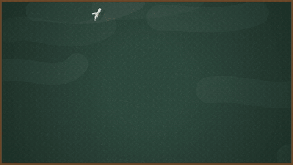<br>
<b>Tablica kredowa</b> · <code>theme: 'chalk'</code><br>
<sub>Film: „Twierdzenie Pitagorasa”<br>kreda z ziarnem tablicy, kolorowa kreda, drewniana rama.<br>Do czego: lekcje, matematyka.</sub>
</td>
<td width="33%" valign="top">
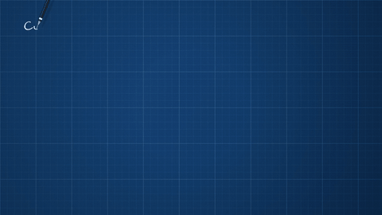<br>
<b>Blueprint</b> · <code>theme: 'blueprint'</code><br>
<sub>Film: „Co się dzieje po kliknięciu?”<br>rapidograf o stałej grubości, siatka, kreskowanie 45°.<br>Do czego: architektura systemów, inżynieria.</sub>
</td>
<td width="33%" valign="top">
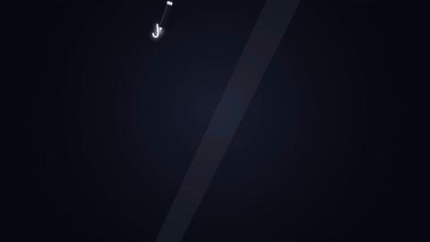<br>
<b>Neon (lightboard)</b> · <code>theme: 'neon'</code><br>
<sub>Film: „Jak uczy się sieć neuronowa?”<br>świecące kreski na ciemnej szybie, pisak z poświatą.<br>Do czego: technologia, AI.</sub>
</td>
</tr>
<tr>
<td width="33%" valign="top">
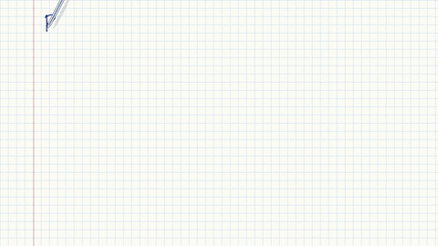<br>
<b>Zeszyt w kratkę</b> · <code>theme: 'notebook'</code><br>
<sub>Film: „Procent składany”<br>długopis, czerwony długopis, zakreślacze, kratka i margines.<br>Do czego: finanse osobiste, nauka.</sub>
</td>
<td width="33%" valign="top">
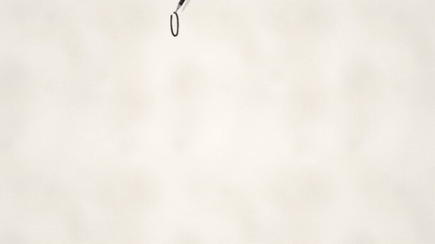<br>
<b>Akwarela</b> · <code>theme: 'watercolor'</code><br>
<sub>Film: „Obieg wody”<br>cienkopis i plamy farby z rozlanym brzegiem, pędzel w ręce.<br>Do czego: przyroda, opowieści.</sub>
</td>
<td width="33%" valign="top">
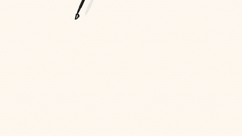<br>
<b>Komiks</b> · <code>theme: 'comic'</code><br>
<sub>Film: „Dlaczego niebo jest niebieskie?”<br>pędzelek z naciskiem, raster kropek, dymki, Bangers.<br>Do czego: ciekawostki, social media.</sub>
</td>
</tr>
<tr>
<td width="33%" valign="top">
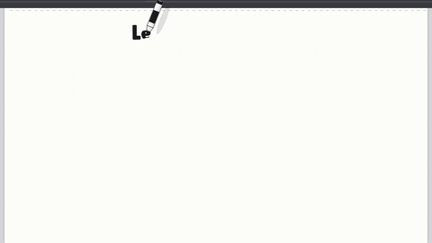<br>
<b>Flipchart</b> · <code>theme: 'flipchart'</code><br>
<sub>Film: „Lejek sprzedażowy”<br>gruby marker ze smugą filcu, arkusz z bloku.<br>Do czego: warsztaty, sprzedaż.</sub>
</td>
<td width="33%" valign="top">
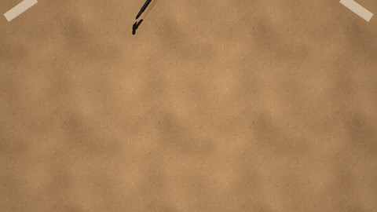<br>
<b>Papier pakowy</b> · <code>theme: 'kraft'</code><br>
<sub>Film: „Kawa z dripa”<br>czarny pisak, biały żelopis, kredki na kraftowym papierze.<br>Do czego: przepisy, rękodzieło.</sub>
</td>
<td width="33%" valign="top">
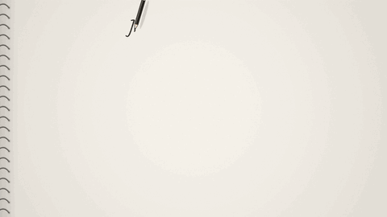<br>
<b>Szkic ołówkiem</b> · <code>theme: 'sketch'</code><br>
<sub>Film: „Jak działa dźwignia?”<br>grafit z ziarnem papieru, szkicowe linie, kreskowanie.<br>Do czego: fizyka, technika.</sub>
</td>
</tr>
<tr>
<td width="33%" valign="top">
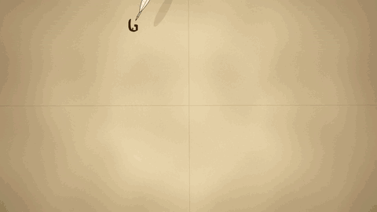<br>
<b>Stara mapa</b> · <code>theme: 'parchment'</code><br>
<sub>Film: „Grunwald 1410”<br>pióro gęsie z kałamarza (kreska blednie), pergamin z plamami, przypalone brzegi.<br>Do czego: historia, bitwy, podróże.</sub>
</td>
<td width="33%" valign="top">
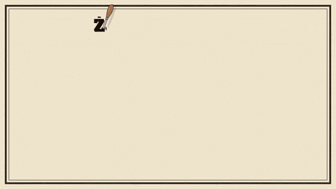<br>
<b>Drzeworyt</b> · <code>theme: 'woodcut'</code><br>
<sub>Film: „Jak dawniej wytapiano żelazo”<br>gruba rytowana kreska, kolor jako nacięcia dłuta, czerń i czerwień.<br>Do czego: dawne techniki, rzemiosło.</sub>
</td>
<td width="33%" valign="top">
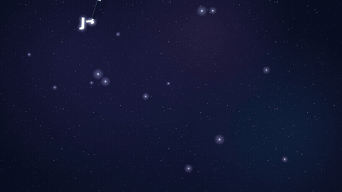<br>
<b>Kosmos</b> · <code>theme: 'cosmos'</code><br>
<sub>Film: „Jak powstaje gwiazda”<br>świecąca pastelowa kreska, mgławice plamą dodającą światła.<br>Do czego: astronomia, fizyka.</sub>
</td>
</tr>
<tr>
<td width="33%" valign="top">
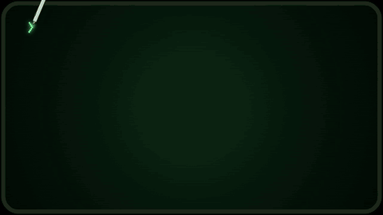<br>
<b>Terminal CRT</b> · <code>theme: 'terminal'</code><br>
<sub>Film: „Apollo 11 i alarm 1202”<br>zielony fosfor, linie ekranu, kineskop, pióro świetlne.<br>Do czego: historia techniki, komputery.</sub>
</td>
<td width="33%" valign="top">
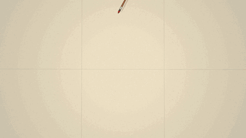<br>
<b>Plakat</b> · <code>theme: 'poster'</code><br>
<sub>Film: „Enigma”<br>płaska kryjąca farba z ziarnem druku, czerwień i czerń, wysoki tytuł.<br>Do czego: historia XX wieku, wojna.</sub>
</td>
<td width="33%" valign="top">
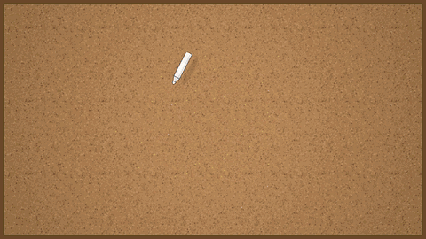<br>
<b>Tablica korkowa</b> · <code>theme: 'corkboard'</code><br>
<sub>Film: „Titanic: łańcuch błędów”<br>karteczki, pinezki, marker i czerwona nitka łącząca wątki.<br>Do czego: zagadki historii, przyczyny.</sub>
</td>
</tr>
<tr>
<td width="33%" valign="top">
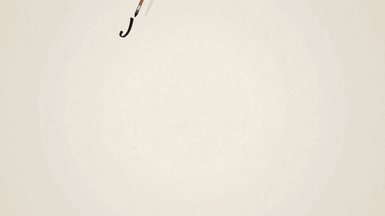<br>
<b>Tusz i pędzel</b> · <code>theme: 'sumi'</code><br>
<sub>Film: „Jak rosną góry”<br>pędzel gruby w poprzek ostrza, laweowanie tuszem, czerwona pieczęć.<br>Do czego: przyroda, geografia.</sub>
</td>
<td width="33%" valign="top">
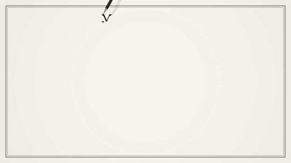<br>
<b>Rysunek patentowy</b> · <code>theme: 'patent'</code><br>
<sub>Film: „Jak działa maszyna parowa”<br>grafion, przekroje kreskowane 45°, numerowane odsyłacze, FIG. 1.<br>Do czego: technika, wynalazki.</sub>
</td>
<td width="33%" valign="top">
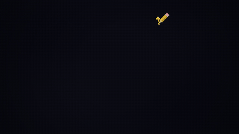<br>
<b>Pixel art</b> · <code>theme: 'pixel'</code><br>
<sub>Film: „Pong 1972”<br>kreska przyciągnięta do siatki 8 px, kolor kratka po kratce, pikselowy ołówek.<br>Do czego: historia gier i komputerów.</sub>
</td>
</tr>
<tr>
<td width="33%" valign="top">
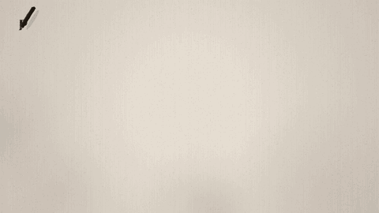<br>
<b>Węgiel</b> · <code>theme: 'charcoal'</code><br>
<sub>Film: „Pompeje: ostatni dzień”<br>ziarnista kreska węgla, cienie roztarte palcem, sangwina.<br>Do czego: historia, katastrofy.</sub>
</td>
<td width="33%" valign="top">
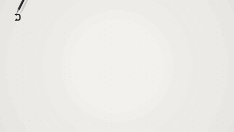<br>
<b>Izometria</b> · <code>theme: 'iso'</code><br>
<sub>Film: „Droga wiadomości”<br>szkice przedmiotów w 3D: mocna sylwetka, blade detale, zasłonięte linie się nie rysują, jeden akcent.<br>Do czego: sprzęt, sieci, architektura systemów.</sub>
</td>
<td width="33%" valign="top">
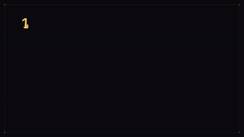<br>
<b>ASCII</b> · <code>theme: 'ascii'</code><br>
<sub>Film: „ASCII: alfabet komputerów”<br>rysunki zamieniają się w znaki (kreska → - / | \, plama → . : # @), napisy zostają tekstem, kursor-blok w ręce.<br>Do czego: historia komputerów, internet, kultura cyfrowa.</sub>
</td>
</tr>
</table>

Przedmioty w 3D (izometria) rysuje się przez `src/iso.js`: `isoCamera`, `solid`,
`cylinder`, `visible`. Geometria pochodzi z [Hairline](https://github.com/lucasmarkes/hairline)
(MIT, Lucas Marques), zasady rysowania brył są w [docs/ZASADY.md](docs/ZASADY.md), sekcja 7.

Motyw może też przepuścić gotową klatkę przez filtr (`theme.post`). Tak działa
styl ASCII (`src/ascii.js`): ręka rysuje zwykłe kreski, a ekran pokazuje je jako znaki.

Jak działa motyw, czym różnią się kreski (`ink`, `chalk`, `tech`, `neon`,
`marker`, `graphite`, `pixel`) i jak zrobić własny styl: [docs/STYLE.md](docs/STYLE.md).

## Rolki 9:16 — przykłady

<table>
<tr>
<td width="33%" align="center" valign="top">
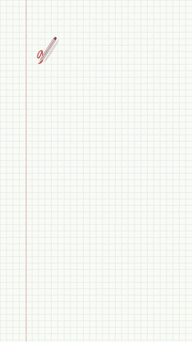<br>
<b>Zeszyt w kratkę</b><br><sub>„Zasada 50/30/20”</sub>
</td>
<td width="33%" align="center" valign="top">
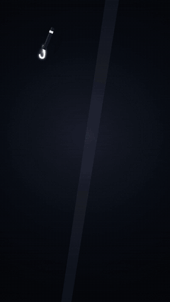<br>
<b>Neon</b><br><sub>„Jak AI pisze tekst?”</sub>
</td>
<td width="33%" align="center" valign="top">
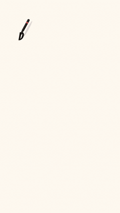<br>
<b>Komiks</b><br><sub>„Dlaczego lód pływa?”</sub>
</td>
</tr>
</table>

```js
const sb = new Storyboard({ format: 'reel', theme: 'neon' }); // kadr 720×1280 → render 1080×1920
```

Szczegóły (strefy bezpieczne, napisy, tempo): sekcja [Rolki 9:16](#rolki-916-reels-tiktok-shorts)
niżej. Podgląd w ramce telefonu: `examples/reels.html`.

## Start

```bash
npm start            # serwer statyczny na http://localhost:8080
npm test             # testy jednostkowe (node:test)
npm run lint         # fizyka, kolejność, tempo, przestoje, skoki ręki we wszystkich scenach (Playwright)
npm run audit        # czas klatki i płynność ręki wszystkich filmów (budżet p95 ≤ 33 ms)
npm run check        # wszystko powyżej — przed każdym pushem
```

Otwórz `http://localhost:8080` — galeria z demami:

| demo | co pokazuje |
| --- | --- |
| `examples/styles.html` | 21 stylów, każdy jako film z lektorem i napisami |
| `examples/reels.html` | rolki 9:16 w ramce telefonu, przełącznik stref interfejsu |
| `examples/narrated.html` | explainer z lektorem: głos, synchronizacja ze słowami, napisy na żywo |
| `examples/hero.html` | nagłówek w stylu stentor.studio: jedna ręka prowadzi główny wątek, maskotka śledzi ołówek wzrokiem |
| `examples/explainer.html` | film ze `Storyboard`: kamera, ścieranie, odtwarzacz z suwakiem, nagrywanie WebM |
| `examples/scroll.html` | diagram budujący się podczas przewijania (sticky canvas + lista) |

Styl i technika wzorowane na animacjach z [stentor.studio](https://stentor.studio)
— szczegółowa analiza klatka po klatce w [docs/ANALIZA.md](docs/ANALIZA.md).

## Najkrótszy film

```html
<link href="https://fonts.googleapis.com/css2?family=Caveat&family=Caveat+Brush&display=swap" rel="stylesheet" />
<canvas id="c"></canvas>
<script type="module">
  import { Player, Storyboard, rect, line, curve } from './src/index.js';

  const sb = new Storyboard({ w: 1280, h: 720 });
  sb.write('Jak działa agent?', 640, 110, { size: 72, font: 'title', align: 'center' });
  const box = rect(520, 260, 240, 160);
  sb.pen(box, { color: 'ink' });                       // ołówek obrysowuje
  sb.crayon(box, { color: 'teal' });                    // kredka zamalowuje (pod konturem)
  sb.write('LLM', 640, 365, { size: 80, align: 'center' });
  sb.arrow(curve([[770, 340], [900, 300], [1000, 340]]));
  sb.camera({ x: 640, y: 340, zoom: 1.8 }, { dur: 1.2 });
  sb.wait(1).camera({ zoom: 1 }).clear();               // zjazd kamerą i starcie tablicy
  sb.write('Koniec!', 640, 360, { size: 90, align: 'center' });

  new Player(document.getElementById('c'), sb.scene());
</script>
```

Ołówek ma ciągłą trajektorię przez cały film (`HandTrack`). Prowadzi kreski,
koloruje kredką, pisze litery, przelatuje łukiem do kolejnego elementu, czeka
obok rysunku i na końcu schodzi z kadru. Czas kroku wynika z modelu ręki: każda
kreska ma powolny start i koniec, ręka zwalnia na zakrętach, a między kreskami
podnosi ołówek. Można też podać czas wprost przez `dur`.

## Architektura

```
src/
  math.js        clamp, lerp, szum 1D, RNG z ziarnem, easingi
  paths.js       ścieżki jako tablice punktów: catmull, resample, pointAt,
                 line/polyline/rect/ellipse/circle/arc/polygon/star/wave/spiral, svgPath(d)
  sketch.js      Sketch — pędzle: pen, strokes, arrow, crayon, fill, liquid,
                 highlight, dot, write, tool, paper, group, occlude
  hand.js        model ręki: StrokePlan (profil prędkości, podnoszenie ołówka),
                 HandTrack (ciągła trajektoria ołówka przez cały film)
  handwriting.js pismo kreskami: szkielet glifów (Zhang–Suen) -> kreski w
                 kolejności pisania -> odsłanianie maską wzdłuż kresek
  timeline.js    Timeline — nazwane odcinki czasu (at / with / after / gap / ease)
  storyboard.js  Storyboard — deklaratywny scenariusz filmu + kamera + rozdziały
  player.js      Player (canvas, DPR, rAF, start w kadrze, idle, reduced motion),
                 scrollDrive (czas sceny = pozycja scrolla)
  record.js      recordWebM, snapshot, download
  narration.js   Voice/Beat (voice.json: klipy zdań + czasy słów), napisy SRT/VTT
  audio.js       AudioTrack — ścieżka lektora (Web Audio), zegar animacji
  themes.js      style: papier, tablica kredowa, blueprint, neon (tło, kreska, narzędzie)
tools/render.mjs render klatka po klatce (Playwright) -> PNG / MP4 (ffmpeg)
tools/audit.mjs  pomiar: czas renderu klatki, teleporty, prędkość i znikanie ręki
tools/lint.mjs   kontrola fizyki scen w przeglądarce (nic nie pojawia się bez ręki)
tools/voice/     voice.py: skrypt -> głos (TTS) / nagranie -> czasy słów (voice.json)
```

**Zasada:** scena jest czystą funkcją czasu. `draw(sk, t)` rysuje wszystko od
zera dla czasu `t`, a każdy pędzel dostaje postęp `p ∈ [0,1]`. Wszystkie
„losowe” drgania pochodzą z ziaren, więc ta sama klatka zawsze wygląda tak samo
— można przewijać, zapętlać, sterować scrollem i eksportować bez gubienia klatek.

### Scena pisana ręcznie (pełna kontrola)

```js
import { Timeline, Player, rect, clamp } from './src/index.js';

const tl = new Timeline().add('box', 1.2).add('fill', 0.8, { gap: -0.3 });
const box = rect(100, 100, 300, 200);

const scene = {
  w: 600, h: 400, duration: tl.duration, idle: 'boil',
  draw(sk, t) {
    sk.paper(600, 400);
    sk.crayon(box, tl.p('fill', t), { color: 'ochre' });
    const tip = sk.pen(box, tl.p('box', t), { color: 'ink', w: 4 });
    if (tip && !tip.done) sk.pencil(tip.x, tip.y);
  },
};
new Player(canvas, scene, { trigger: 'view' });
```

### Pędzle (`Sketch`)

| metoda | opis | ważne opcje |
| --- | --- | --- |
| `pen(pts, p, o)` | kreska z naciskiem, zwraca końcówkę `{x,y,angle,done}` | `w`, `color`, `jitter`, `seed`, `taper`, `dash:[on,off]`, `sketchy`, `still` |
| `strokes(list, p, o)` | kilka kresek jak ręka: profil prędkości, podnoszenie ołówka; zwraca końcówkę z `lift` | jak `pen`, `plan` |
| `arrow(pts, p, o)` | trzon + dwa ramiona grota (osobne ruchy ręki) | `head` |
| `crayon(poly, p, o)` | zamalowanie zygzakiem z ziarnem (długie kształty — krótkimi ruchami w poprzek) | `color`, `alpha`, `spacing`, `w`, `angle`, `grain`, `holes`, `solid` |
| `liquid(poly, level, o)` | napełnianie od dołu z falą | `color`, `alpha`, `wave`, `speed` |
| `highlight(pts, width, p, o)` | zakreślacz (`multiply`) | `color`, `alpha` |
| `write(text, x, y, p, o)` | pismo prawdziwymi kreskami liter (kropki i ogonki na końcu słowa), zwraca pozycję pisaka | `size`, `font` (`hand`/`title`/`mono`/CSS), `align`, `color`, `\n`, `fit`, `mode: 'wipe'` |
| `tool(x, y, o)` | narzędzie w ręce z końcówką w (x,y): `type` `pencil` (kolor rysika = `color`), `marker`, `eraser` | `type`, `color`, `angle`, `lean`, `lift` (0..1), `size`, `width` |
| `fill`, `occlude`, `dot`, `paper`, `group` | wypełnienia, zasłanianie tła, kropki, papier, układ lokalny | |

Kolory: nazwy z palety (`ink`, `pen`, `teal`, `sky`, `ochre`, `coral`, `plum`,
`paper`, …) albo dowolny CSS. Paletę i czcionki można nadpisać:
`new Player(canvas, scene, { sketch: { palette: {...}, fonts: { hand: '"Moja", cursive' } } })`.

### Storyboard — kroki

`pen`, `strokes`, `arrow`, `crayon`, `fill`, `liquid`, `highlight`, `write`,
`dot`, `pop(x, y, fn)` (wyskakuje z przestrzeleniem), `custom(fn(sk, p, t), { trace })`,
`wait(s)`, `mark(name)`, `camera({x,y,zoom}, {dur})`, `clear({dur})`.

**Zasada fizyki sceny: nic nie pojawia się samo.** Każdy ślad robi jedna ręka
z narzędziem:
* **ołówek w kolorze kreski**: grafit dla czerni, kredka dla koloru
  (`pen`, `strokes`, `arrow`, `write`, `crayon`, `dot`, `liquid`);
* **zakreślacz**: `highlight` i kryjące `fill`;
* **gąbka**: `clear` ściera pasami, a zmazane jest dokładnie to, przez co
  przeszła.

Ręka zmienia narzędzie w powietrzu między krokami. Krok nie może wymagać
szybszej ręki niż fizyczny limit (`HAND.maxSpeed`, ~3200 px/s po kartce,
4500 px/s w powietrzu); w razie potrzeby czas kroku się wydłuża. Kroki `custom`
prowadzi ręka, jeśli podasz `trace(p) => {x, y, tool?}`. Przykład: postać
w `examples/scenes/mascot.js` (`Sequence`: kontur → oczy → kredka z ominięciem
oczu → źrenice → detale).

Świadome wyjątki trzeba nazwać:
* `ambient: true`: animacja już narysowanego elementu (para z kubka, oddech);
* `magic: true`: efekt bez ręki (`pop`);
* `fast: true`: wyłącza limit prędkości.

`sb.lint()` zwraca listę problemów: element bez ręki, ręka spóźniona albo
niezdążająca, rysowanie równoległe, przerwany obiekt (patrz niżej), a w
przeglądarce także za szybkie pismo.
Przy pierwszym rysowaniu problemy trafiają do konsoli. Pełna kontrola
z prawdziwymi czcionkami:

```bash
node tools/lint.mjs                                   # wszystkie dema
node tools/lint.mjs examples/scenes/moja.js:buildMoja # własna scena (kod wyjścia 1 przy problemach)
```

**Zasada kompletności obiektu (też w `lint`): obiekt rysujesz w całości,
zanim zaczniesz następny: kontur → kolor → detale → podpis.** Jeśli słońce
ma być żółte, ręka maluje je zaraz po obrysie, a nie wraca do niego po
narysowaniu morza. Zaznaczenia (kółko, zakreślenie) to nowe obiekty.
Świadomy, fabularny powrót oznacz `revisit: true`.

Pełne zasady rysownika (także te, których lint nie sprawdzi, np. pierwszy plan
przed tłem, brak zakrytych linii) są w [docs/ZASADY.md](docs/ZASADY.md). Ten
plik jest promptem źródłowym dla każdego, kto pisze sceny: człowieka albo
modelu.

Opcje storyboardu: `handGaps` (przerwa na przelot ołówka przed kolejnym
elementem, domyślnie włączona), `speed` (tempo ręki w px/s), `cache` (bufor
ukończonych elementów, przerysowywany tylko przy zmianie klatki drgania lub
ruchu kamery), `idle`, `fps`.

Opcje czasu w każdym kroku: `dur`, `at` (sekunda albo nazwa kroku), `with`
(razem z krokiem), `after`, `gap` (przesunięcie, może być ujemne), `ease`,
`name`, `keep` (przetrwa `clear`), `pencil` (pokaż/ukryj ołówek), `z` (warstwa).

### Odtwarzacz

```js
const player = new Player(canvas, scene, {
  trigger: 'view',      // 'mount' | 'view' | 'manual'
  delay: 0.3,
  speed: 1,
  onTime: (t) => {},
});
player.play(); player.pause(); player.seek(3.2); player.renderAt(5);
```

`idle` sceny: `'boil'` (po intro kreski dalej drgają 8×/s), `'loop'` (czas płynie
dalej — oddech, mruganie; `fps` ogranicza klatki), `'still'` (stop),
`'restart'` (zapętlenie całości).

Sterowanie scrollem:

```js
const player = new Player(canvas, scene, { trigger: 'manual' });
scrollDrive(player, document.querySelector('#sekcja'), { smooth: 0.15 });
```

## Pomiar jakości ruchu

```bash
node tools/audit.mjs examples/explainer.html   # czas klatki, widoczność ołówka, teleporty
```

Wyniki przed i po przebudowie ręki są w [docs/PLAN.md](docs/PLAN.md).

## Lektor i napisy

Każde zdanie lektora to `sb.say(beat, () => { ...rysunek... })`. Krok
z `cue: 'słowo'` czeka na to słowo: ołówek dotyka kartki 0,3 s przed nim, a
lektor czeka na rękę, jeśli ta nie zdąży. Głos pochodzi z syntezy mowy albo
z Twojego nagrania; w obu przypadkach czasy słów daje `tools/voice/voice.py`.
W przeglądarce dźwięk jest zegarem animacji. `tools/render.mjs` składa MP4
z lektorem i ścieżką napisów oraz zapisuje pliki SRT i VTT.

```js
const voice = await Voice.load('voice/agent/voice.json');
sb.say(voice.beat(3), () => {
  sb.arrow(strzalka, { cue: 'trafia' });   // "Obserwacja TRAFIA do modelu…"
  sb.pen(ramka);
});
new Player(canvas, sb.scene()).play();     // play() z kliknięcia — przeglądarka wymaga gestu
```

Jak dać głos, format skryptu i polecenia: [docs/LEKTOR.md](docs/LEKTOR.md).
Demo: `examples/narrated.html`.

## Style

Ta sama scena w innym stylu wymaga zmiany jednej linijki:
`new Storyboard({ theme: 'chalk' })`. Wbudowane motywy: `paper` (domyślny,
pióro na kremowym papierze), `chalk`, `blueprint`, `neon`, `notebook`,
`watercolor`, `comic`, `flipchart`, `kraft`, `sketch`. Podglądy wszystkich są
w [galerii](#galeria-stylów) na górze.

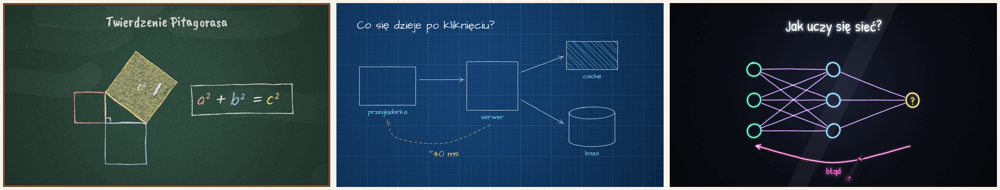

Co zmienia motyw, jak zrobić własny i pomysły na kolejne style:
[docs/STYLE.md](docs/STYLE.md). Demo: `examples/styles.html`.

## Rolki 9:16 (Reels, TikTok, Shorts)

```js
const sb = new Storyboard({ format: 'reel', theme: 'neon' }); // kadr 720×1280
```

```bash
node tools/render.mjs "examples/reels.html?r=neon" --mp4   # 1080×1920
```

* **Strefy bezpieczne.** Góra (do 150), dół (od 900) i prawy pas (od 640)
  zasłania interfejs aplikacji: nick, opis, przyciski. `lint` ostrzega, gdy
  rysunek tam wchodzi.
* **Napisy wypalone w obraz.** Po 2–3 słowa, wersalikami, a słowo, które
  właśnie pada, jest podświetlone i lekko powiększone. Czasy słów biorą się
  z `voice.json`. To warstwa interfejsu, a nie rysunek, więc nie rysuje jej
  ręka. Krój: Montserrat Bold (pełne polskie znaki). Opcje:
  `captions: { size, y, font, weight, color, highlight, upper }` albo
  `captions: false`.
* **Tempo rolki.** Hak w pierwszym zdaniu (pytanie, problem), duże elementy,
  jedna myśl na zdanie, 15–20 s.

Demo: `examples/reels.html`.

## Od skryptu do filmu

Jak wygląda zrobienie filmu z Twojego skryptu: [docs/PRODUKCJA.md](docs/PRODUKCJA.md)
(research: [docs/PRODUKCJA-research.md](docs/PRODUKCJA-research.md)).
Produkcja seryjna mniejszymi modelami: [docs/SKALOWANIE.md](docs/SKALOWANIE.md).

## Eksport wideo

* **W przeglądarce**: `const blob = await recordWebM(player, { fps: 30 }); download(blob, 'film.webm')`
  (przyciski „nagraj WebM” w demach).
* **Klatka po klatce do MP4** (wymaga `npm i -D playwright` i ffmpeg):

  ```bash
  node tools/render.mjs examples/explainer.html --out out/explainer --mp4   # Full HD, 30 kl./s
  node tools/render.mjs "examples/reels.html?r=neon" --mp4                  # rolka 1080×1920
  node tools/render.mjs examples/hero.html --fps 4 --sheet                  # arkusz klatek do podglądu
  ```

  MP4 domyślnie w Full HD (inny rozmiar: `--width`). Klatki liczy równolegle kilka
  przeglądarek (`--jobs`, domyślnie do 4), a ffmpeg koduje film w trakcie. Wynik jest
  identyczny jak przy jednym wątku. Lektor jest wyrównany do -16 LUFS (głośność jak
  w serwisach wideo), a film trwa dokładnie tyle co obraz. Strona musi wystawiać
  `window.__player`.

## Własna postać

`examples/scenes/mascot.js` pokazuje przepis na postać: kontur `strokes`
→ `occlude` (zasłania tło) → `crayon` → detale (`dot`, oczy z `fill`) → idle
(oddech przez skalę `group`, mruganie co kilka sekund, wzrok śledzący ołówek).
Gotowe rysunki z Figmy/Inkscape można wczytać przez `svgPath(d)` i animować
ołówkiem jak każdą inną ścieżkę.

## Dokumentacja

| plik | o czym |
| --- | --- |
| [docs/ZASADY.md](docs/ZASADY.md) | zasady rysownika: prompt źródłowy dla człowieka i modelu (fizyka ręki, obiekt w całości, lektor, rolki) |
| [docs/STYLE.md](docs/STYLE.md) | motywy: co zmieniają, jak zrobić własny |
| [docs/KOD.md](docs/KOD.md) | zasady kodu: architektura, płynność ręki, budżet klatki, lista kontrolna nowego stylu |
| [docs/LEKTOR.md](docs/LEKTOR.md) | głos z tekstu albo nagrania, format skryptu, synchronizacja |
| [docs/PRODUKCJA.md](docs/PRODUKCJA.md) | jak powstaje film ze skryptu |
| [docs/SKALOWANIE.md](docs/SKALOWANIE.md) | produkcja seryjna mniejszymi modelami (specyfikacja, linter, few-shot) |
| [docs/PLAN.md](docs/PLAN.md) | historia zmian silnika i pomiary |
| [docs/ANALIZA.md](docs/ANALIZA.md) | analiza animacji stentor.studio klatka po klatce |
| [CLAUDE.md](CLAUDE.md) | instrukcje dla Claude Code w tym repozytorium |
