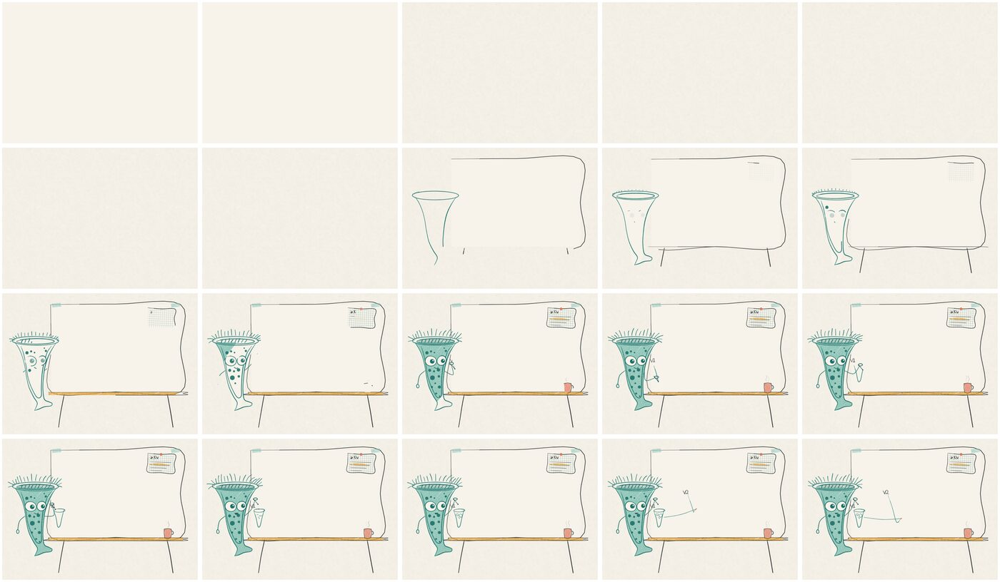
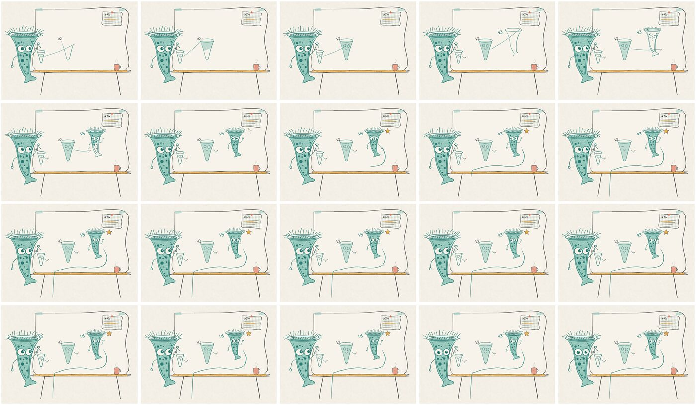
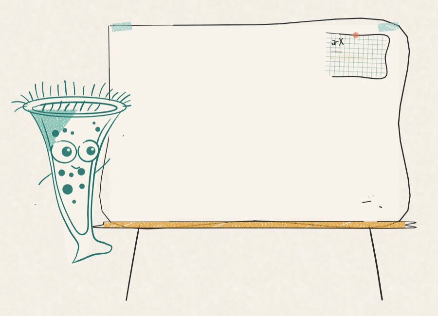
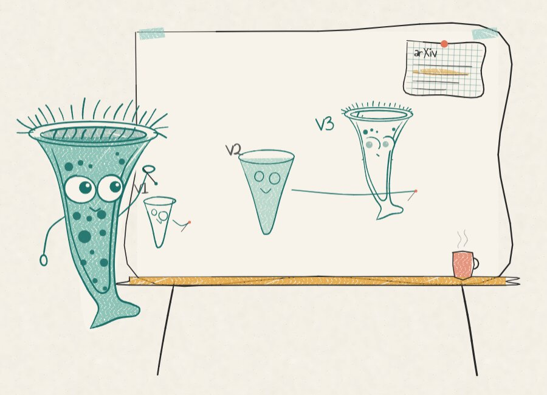
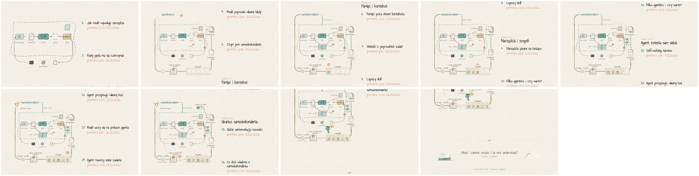

# Analiza animacji z stentor.studio

Strona otwarta w Chromium (Playwright), viewport 1440×900. Intro nagrane jako
70 kolejnych klatek (co ~0,38 s), sekcja playlisty jako zrzuty co 800 px
przewinięcia. Do tego przejrzany kod JS strony (moduły Next.js/Turbopack), żeby
zrozumieć technikę, a nie tylko efekt.

## Co widać na ekranie

Kolejność rysowania w nagłówku (~7 s):

1. **Kontury pierwsze.** Tablica, statyw i maskotka rysują się cienką kreską,
   kilka kresek naraz. Kreska ma zwężone końce i lekko „pływa” (nie jest
   wektorowo idealna).
2. **Potem kredka.** Wnętrze maskotki zamalowuje się ukośnym zygzakiem,
   widać kierunek ruchu ręki. Na kolorze są białe rysy jak od faktury papieru.
   
3. **Detale.** Oczy, kropki, uśmiech, rzęski (rzęski rosną na końcu).
   Tasiemki, notatka „arXiv” na kratce, kubek z parą, ochrowa półka.
4. **Opowieść na tablicy.** Pismem odręcznym „V1”, mała wersja postaci;
   **ołówek** (mały pisak z czerwoną końcówką) ciągnie linię do „V2”, V2 jest
   „napełniany” kolorem jak ciecz, potem V3, wyskakuje gwiazdka.
   
5. **Nić w dół.** Z V3 wychodzi linia, schodzi przez półkę poza kadr i jest
   kontynuowana przez stronę przy przewijaniu (kropka-kotwica pod nagłówkiem).
6. **Idle.** Po intro scena nie zamiera: oddech postaci, mruganie, rzęski
   falują, para z kubka, kreski delikatnie drgają (line boil).

Sekcja playlisty: canvas jest `sticky` po lewej, po prawej lista odcinków.
Przewijanie dokłada kolejne elementy diagramu (pętla agenta, narzędzia,
pamięć, ocena, samodoskonalenie).

## Jak to jest zrobione technicznie

* **Canvas 2D, nie SVG/wideo.** 5 elementów `<canvas>`, zero `<video>`.
  Podkreślenie tytułu to jedyny SVG (`pathLength="1"` + przejście
  `stroke-dashoffset`).
* **Scena = czysta funkcja czasu.** Obiekt
  `{ w, h, intro, idle: "loop", fps, draw(sketch, t) }` — w każdej klatce
  wszystko rysowane od zera dla czasu `t`. Brak stanu => da się przewijać,
  zapętlać, sterować scrollem.
* **Ścieżki to tablice punktów**: krzywa Catmulla-Roma przez punkty
  kontrolne + równomierne próbkowanie po długości. Postęp `p` mówi, ile
  punktów narysować.
* **Pióro**: punkty przesuwane gładkim szumem 1D (ziarno kreski + numer klatki
  „drgania”), grubość zmienna — zwężenie końców i lekkie wahania nacisku.
* **Line boil**: numer klatki drgania zmienia się 8×/s, więc kreski żyją jak
  w animacji poklatkowej.
* **Kredka**: zygzak przycięty (`clip`) do konturu na pomocniczym płótnie,
  potem `destination-out` z wzorem ziarna (białe rysy), na końcu
  nałożenie na główny canvas z przezroczystością.
* **Pismo**: litera po literze, każda z własnym drobnym obrotem i
  przesunięciem, bieżąca litera odsłaniana prostokątem `clip`.
* **„Zasłanianie”**: kształty wypełniane kolorem papieru (np. tablica przed
  nogami statywu).
* **Odtwarzacz**: `IntersectionObserver` (start po wejściu w kadr),
  `ResizeObserver` + DPR, wspólna pętla `requestAnimationFrame`,
  `prefers-reduced-motion` => od razu ostatnia klatka, ograniczenie fps w idle.
* Czcionki odręczne wczytywane przez `document.fonts.load` przed rysowaniem.

## Co z tego wynika dla silnika

Silnik w `src/` jest napisany od zera na tych samych zasadach (scena jako
funkcja czasu, ścieżki jako punkty, pędzle z postępem), i rozszerzony o to,
czego potrzeba do **filmów objaśniających**:

| Potrzeba | W silniku |
| --- | --- |
| kreska ołówkiem/piórem | `Sketch.pen`, `strokes`, `arrow` |
| zamalowywanie kredką | `Sketch.crayon` (ziarno, kierunek, odstęp) |
| napełnianie „cieczą” | `Sketch.liquid` |
| pismo odręczne | `Sketch.write` (zwraca pozycję pisaka) |
| widoczny ołówek | `Sketch.pencil` + automatyczne podążanie w `Storyboard` |
| scenariusz bez ręcznego liczenia czasów | `Storyboard` (kroki, `with/after/gap`, `camera`, `clear`) |
| scroll | `scrollDrive` |
| eksport | `recordWebM` w przeglądarce, `tools/render.mjs` → PNG/MP4 |
| import gotowych rysunków | `svgPath(d)` |
